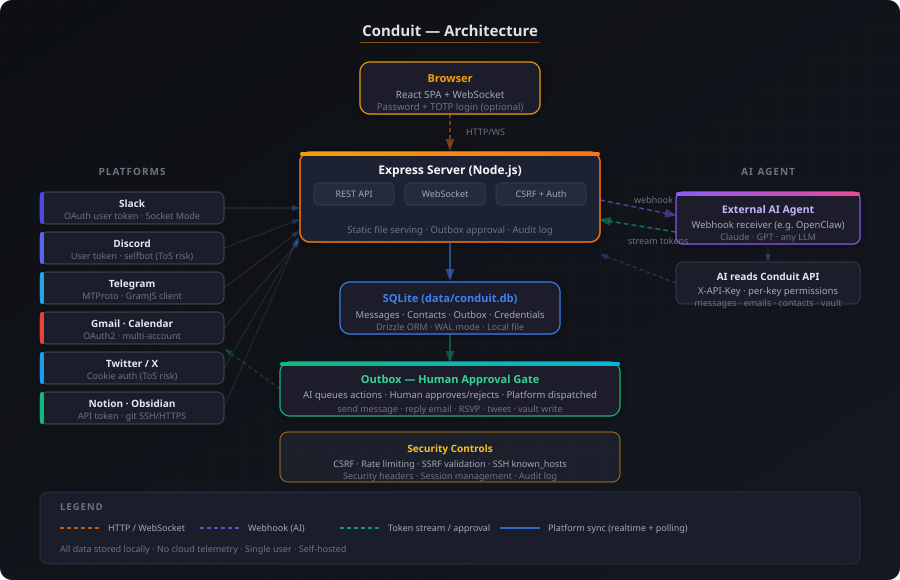

<div align="center">
  
</div>

<br/>

A self-hosted personal communications hub. Aggregates Slack, Discord, Telegram, Gmail, Google Calendar, and Twitter/X into a single unified interface, and exposes a full REST API for AI agent integration — running locally on Node.js with SQLite storage.

<br/>

## Platforms

| Platform | What's supported |
|---|---|
| **Slack** | Messages, DMs, channels, realtime via Socket Mode, unread tracking |
| **Discord** | Messages, DMs, server channels, guild sync, mute state tracking |
| **Telegram** | Private messages, groups, channels, MTProto realtime, folder sync |
| **Gmail** | Full inbox, email body, actions (reply, archive, trash, etc.) |
| **Google Calendar** | Events, RSVP, create/update/delete, Meet links |
| **Google Meet** | AI-generated meeting notes synced from Meet and Google Drive |
| **Twitter / X** | DMs, home feed, mentions, search, tweet analytics |
| **Notion** | Page and database browsing, content reads and writes |
| **Obsidian** | Multi-vault sync via git (SSH or HTTPS), file read/write via outbox |
| **SMB file shares** | Directory listing and file read/write on SMB2 network shares |

---

## Features

- **Unified inbox** — everything new across all platforms at a glance, with a digest-powered "needs attention" strip
- **Chat** — message threads with bubble UI, avatars, cross-platform unread tracking, infinite scroll
- **Contacts** — cross-platform contact list with activity scoring and message history
- **Email** — Gmail inbox with sandboxed HTML rendering and action buttons
- **Calendar** — weekly view, event detail, RSVP, Google Meet AI notes
- **AI agent API** — full REST + OpenAPI spec designed for tool use by LLMs; agents authenticate with an API key, bootstrap from a served skill file, and get a one-call `/api/digest` briefing (needs-reply chats, unread rollups, upcoming events, meeting-note excerpts, pending approvals)
- **Outbox approval** — all AI-generated actions queue for human review before sending, with keyboard-first triage, idempotent submission, retries, and a provenance view showing exactly which agent asked for what
- **Audit log** — complete history of all actions by actor and service
- **Password + TOTP 2FA + passkeys** — optional browser login with WebAuthn, rate limiting, and session management
- **Multi-account Google** — connect multiple Google accounts simultaneously (Gmail, Calendar, Meet Notes)
- **Self-hosted, local-first** — SQLite database, no cloud dependencies, no telemetry

---

## Quick start

```bash
git clone https://github.com/conduit-app/conduit
cd conduit
npm install
make dev
```

Open **http://localhost:3101** and configure services from the Settings page. All credentials are entered in the UI — no config files required.

---

## Docker

```bash
make docker-up    # build image and start
make docker-down  # stop
```

The SQLite database persists in `./data/` on the host and survives container rebuilds.

---

## AI agent integration

Conduit exposes a complete REST API for AI tool use, accessible at `http://localhost:3101/api`.

**Setup:**
1. Go to **Settings → Permissions** and generate an API key
2. Pass `X-API-Key: <your-key>` on every request
3. Install the skill from **Settings → Agents** — it is served live from `GET /api/skill` so it always matches your server version

**MCP:** tool-native agents can instead run the MCP server in [`packages/mcp-server`](packages/mcp-server), which exposes the same API as ~11 typed tools over stdio (set `CONDUIT_URL` and `CONDUIT_API_KEY`). Both paths hit the same REST API and the same approval outbox.

**Efficient access pattern:** agents should start with `GET /api/digest` — one bounded call covering needs-reply chats, unread email, upcoming events, recent meeting notes, and pending approvals — then drill into specific endpoints. The full OpenAPI spec is at `/api/openapi.json`; a human-readable version is in [`docs/api.md`](docs/api.md).

**Outbox flow:** All AI write actions (send message, reply to email, RSVP, tweet, file write) create an outbox item with `status=pending`. A human approves or rejects it in the UI before anything is sent. Submissions support `Idempotency-Key` headers, failed dispatches can be retried, and every item records which API key produced it.

**Permissions:** per-key read/write toggles and fine-grained allowlists (Slack channels, Gmail labels, calendar IDs, vault/share paths, Drive folders) are enforced server-side on every read and write route.

---

## Architecture

<div align="center">
  
</div>

**Stack:** Node.js 20 · Express 5 · SQLite (better-sqlite3) · Drizzle ORM · React 19 · Vite · Tailwind CSS 4 · TypeScript 6 throughout.

---

## Security

Conduit is a **single point of failure** for every account you connect. The local database stores credentials and session tokens for all connected platforms. If the database is accessed by an unauthorized party, all connected accounts are exposed simultaneously.

**Steps to harden your instance:**

1. Enable **password + 2FA login** in Settings → Security
2. Restrict network access to the server (firewall, VPN, or localhost-only binding)
3. Protect `data/conduit.db` from unauthorized file system access
4. Set `TRUST_PROXY=true` only if running behind a reverse proxy you control

**Security controls implemented:**
- Optional password login (bcrypt, cost 12) + TOTP 2FA + passkeys (WebAuthn) with rate limiting
- API key auth (SHA-256 hashed) with per-key, per-service permission grants
- CSRF protection (double-submit cookie) for all UI session requests
- SSRF validation on outbound webhook and git remote URLs
- `X-Content-Type-Options`, `X-Frame-Options`, `Referrer-Policy`, and CSP headers
- SSH strict host key checking (configurable) with stored known_hosts
- Audit log for all actions

See [SECURITY.md](SECURITY.md) for the responsible disclosure policy and known accepted risks.

---

## Platform terms of service

Some connection methods may be worth reviewing against each platform's terms of service.

| Platform | How it connects |
|---|---|
| **Discord** | User token (selfbot) |
| **Twitter / X** | Cookie / credential auth |
| **Telegram** | MTProto (official client API) |
| **Slack** | Official OAuth user token |
| **Gmail / Google Calendar** | OAuth2 (official API) |
| **Notion** | Official integration token |
| **Obsidian** | Local git repository |

---

## Development

```bash
make dev      # start server (port 3100) + Vite dev server (port 3101)
make build    # production build
make migrate  # run database migrations
make test     # run server tests
make lint     # typecheck both packages
```

In development, Vite runs on port `3101` and proxies API calls to the server on port `3100`. In production, the server serves both API and UI on port `3101`.

---

## Configuration

Conduit has no configuration files. All credentials are entered through the web UI.

| Variable | Default | Description |
|---|---|---|
| `PORT` | `3101` | Server listen port |
| `DATABASE_PATH` | `data/conduit.db` | Path to the SQLite database file |
| `TRUST_PROXY` | _(unset)_ | Set to `true` to trust `X-Forwarded-*` headers from a reverse proxy |
| `DOCKER` | _(unset)_ | Set to `true` in Docker to adjust update behaviour |

---

## Trust model

Conduit runs entirely on your machine. All credentials, tokens, and message data are stored in a single local SQLite database. All platform traffic is routed through the local Node.js process. There are no cloud services, no telemetry, and no data leaves your host except through the platform connections you configure.
